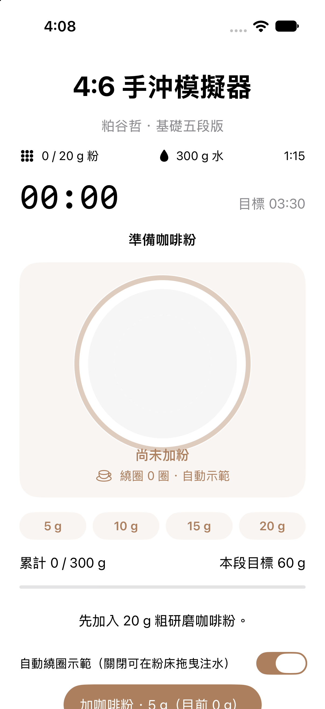

# 4:6 手沖模擬器 ☕

以 SwiftUI 製作的手沖咖啡互動練習 App，主題參考粕谷哲的 4:6 沖煮法。透過加入咖啡粉、分段注水、計時及繞圈操作，練習圖片、文字與按鈕如何隨 `@State` 更新。

## App 畫面

## 主要功能

| 功能 | 操作與畫面變化 |
| --- | --- |
| 分次加粉 | 每次加入 5 g；咖啡粉圖像的面積與顆粒數隨 5、10、15、20 g 增加。 |
| 開始沖煮 | 加滿 20 g 才能開始，計時器與注水畫面同步更新。 |
| 五段注水 | 每段增加 60 g，總水量 300 g；達到本段目標會自動停水。 |
| 自動繞圈 | 顯示繞圈落點、水流、漣漪與累計圈數。 |
| 手動注水 | 關閉自動示範後，在粉床內按住並拖曳；放開即停止注水。 |
| 暫停與繼續 | 可暫停整體沖煮，也能單獨停止或恢復本段注水。 |
| 重新沖煮 | 清除咖啡粉、水量、計時與圈數，回到準備狀態。 |

## 使用步驟

1. 點選「加咖啡粉 · 5 g」四次，準備 20 g 粗研磨咖啡粉。
2. 選擇保留自動繞圈，或關閉開關改為手動拖曳。
3. 點選「開始沖煮與計時」。
4. 每段到達目標水量後，等待下一段時間，再按「下一段」繼續。自動示範只負責繞圈與注水，分段仍需按鈕確認。
5. 累計注入 300 g，且計時到達 3 分 30 秒後，顯示完成。
6. 若想重新練習，點選「重新沖煮」。

手機畫面可上下捲動；部分操作按鈕與時間表位於畫面下方。

## 目前 App 的分段設定

咖啡粉 **20 g**、水量 **300 g**，粉水比 **1:15**。

| 段數 | 最早開始時間 | 本段水量 | 累計水量 |
| --- | --- | --- | --- |
| 第一段 | 00:00 | 60 g | 60 g |
| 第二段 | 00:45 | 60 g | 120 g |
| 第三段 | 01:30 | 60 g | 180 g |
| 第四段 | 02:15 | 60 g | 240 g |
| 第五段 | 03:00 | 60 g | 300 g |

前兩段共 120 g，占總水量 40%；後三段共 180 g，占 60%。App 的目標完成時間為 **03:30**；若操作較慢，會繼續計時，直到水量也達到 300 g。

這是目前程式採用的簡化練習時間表。4:6 法可依酸甜與濃度調整各段水量；此表不代表所有 4:6 食譜的固定時間與比例配置。

## SwiftUI 練習重點

- **圖片與文字**：咖啡粉份量、注水狀態、計時、水量與完成提示。
- **Button**：加粉、開始、分段、暫停、繼續與重設。
- **@State**：保存咖啡粉、水量、計時、沖煮階段與注水落點，驅動畫面更新。
- **條件判斷**：未滿 20 g 不可開始；未到下一段時間不可跳段；達標後停水。
- **DragGesture**：在粉床範圍內拖曳，模擬手動移動注水落點。
- **Timer / Combine**：依實際經過時間更新計時與模擬水量。
- **SwiftUI 圖形與動畫**：呈現粉堆、水流、漣漪及份量變化。

作業參考：[彼得潘 #225：結合圖片、文字、Button 的狀態練習](https://medium.com/彼得潘的試煉-勇者的-100-道-swift-ios-app-謎題/225-結合圖片-文字-button-的-swiftui-state-練習題-3cd0ca2b194d)。

## 專案與執行狀態

此 repo 包含 Xcode 專案、SwiftUI 原始碼、Asset Catalog 與 iPhone 截圖，沒有第三方套件依賴。

專案與 scheme 名稱均為 `pour-over-simulator`，SwiftUI 原始碼位於 `Sources` 資料夾。

### 開啟與執行

目前專案使用 Xcode 27 專案格式，iOS Deployment Target 為 **27.0**，macOS Deployment Target 為 **26.6**。請使用可支援此專案格式與系統版本的 Xcode，並安裝對應的模擬器 runtime；低於 Deployment Target 的裝置無法執行。

1. 下載 repo ZIP，或執行 `git clone https://github.com/Yogurtheyork/pour-over-simulator.git`。
2. 在 Xcode 開啟根目錄的 `pour-over-simulator.xcodeproj`。
3. 選擇 `pour-over-simulator` scheme 與 iOS 27.0 或以上的 iPhone 模擬器。
4. 按 **⌘R** 建置並執行。也可選擇符合最低系統版本的 My Mac。

使用實體 iPhone 時，需在 Signing & Capabilities 選擇自己的開發團隊，必要時更換 Bundle Identifier，並完成裝置所需的開發者設定。

### 原始碼位置

- `Sources/MyApp.swift`：App 入口。
- `Sources/ContentView.swift`：沖煮畫面、按鈕、手勢、計時與狀態控制。
- `Sources/Assets.xcassets`：資產目錄。
- `pour-over-simulator.xcodeproj`：專案與建置設定。

`.gitignore` 排除 Xcode 個人操作狀態、建置產物與本機簽署檔。

已確認 Mac 版本可建置，並已在 iPhone 17 模擬器開啟首頁；尚未完成實體 iPhone 驗收。

## 模擬限制

- 水流、繞圈與落水為互動示意，不計算真實萃取率、風味或粉床流體變化。
- 模擬流速為 6 g／秒，自動繞圈設定為每 4 秒一圈。
- App 使用示意圓形軌道，沒有整合影片的落點重建動畫。
- 咖啡粉圖像以份量變化呈現，不是實際粉堆高度的物理模擬。
- 食譜內容供理解分段操作使用；實際沖煮仍須觀察落水情況並調整。

## 參考資料

- [HARIO：Tetsu Kasuya 與 4:6 方法介紹](https://www.hario-europe.com/blogs/hario-community/v60-ambassadors-tetsu-kasuya)
- [元食 cafe：4:6 手沖示範影片](https://www.youtube.com/watch?v=Dm961kf-mnM)

影片為操作觀察參考，App 並非官方產品，也未宣稱精準重現影片軌跡。
